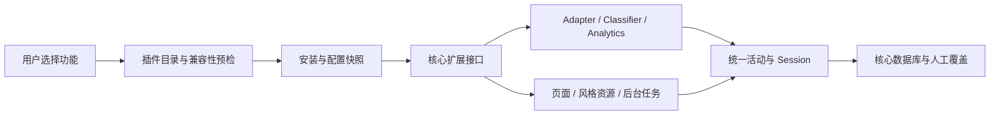

# 核心与可选插件设计

> 本文保留架构开发阶段的设计与验证范围。文中的 `checkpoint/...` 中间标签与 `outputs/...` 证据为本地开发记录，不随公开 Git 历史上传；公开版本的复现与恢复以 [验证记录](verification.md) 和 [回退说明](plugin-rollback.md) 为准。

[返回项目首页](../README.md) · [版本与数据回退](plugin-rollback.md)

边界加固已在独立分支实现，见 [模块边界与最小接口](plugin-boundaries.md)。[官方运行管理器](plugin-runtime.md) 已具备实际启停、配置恢复和五类贡献；[游戏资料及识别迁移](game-plugin-migration.md) 与 [游戏分析/页面迁移](game-analysis-plugin.md) 已接管两批既有功能。[本机插件管理页面](plugin-management.md) 已提供授权、启停和故障反馈。安装、独立包发行、主题包及第三方隔离仍是后续设计目标。

状态：2026-10-16 当前源码已包含核心与官方功能，运行与升级见 [源码运行与升级](local-deployment.md)。独立插件安装的目标仍是后续 v0.5 系列；当前源码版本为 v0.4.0b1。
默认官方模块保留原游戏接入行为，保存的停用选择优先；原 main 已启用本批成果，尚无独立安装中心。
`integrations/plugins/examples/` 是早期描述/依赖预检样例；其中游戏分析的强依赖用于测试预检机制。当前官方运行定义在两个 integration 组装模块中显式登记，游戏分析不依赖 Playnite 运行。诊断例子有对应源码供隔离验证，仍不是可安装包。

## 产品边界

用户安装基础程序后，可以记录电脑活动、查看时间线和基本统计、纠正分类及关联项目。
插件按需提供更具体的内容识别、报告或界面资源。安装是把功能文件加入本机；启用是让它参与运行。
前期提供官方功能包，成熟后再评估第三方开发与隔离；账号、商城、评分体系不属于第一版。

| 核心持续提供 | 插件候选 |
|---|---|
| 基础窗口/AFK 接入协调与默认 ActivityWatch Adapter | 网页内容增强与更多数据源 |
| RawEvent、ActivityEvent、Session、去重和时间计算 | Playnite 游戏资料与进程识别 |
| 基础内容类别、人工覆盖、用户记忆规则 | 游戏类型、偏好和专题分析 |
| 基础用途、项目关联、时间线和日常统计 | 项目进阶报告、专注目标 |
| SQLite、事务、迁移、备份恢复和本机访问保护 | 高级导出、后续 AI 分类与云备份 |
| 默认可用界面、风格切换机制与减少动态效果 | 可独立安装的界面风格资源包 |

ActivityWatch Web Watcher 安装在浏览器，Playnite 连接扩展安装在 Playnite；LeisureLog 功能插件可以引导接入这些外部组件，但不能把它们当作已经安装在 LeisureLog 里的模块。

## 保持模块化单体

核心与官方插件仍可在同一应用进程运行，通过接口贡献能力。所有活动使用统一的数据和计时模型。
插件不各自建立一套原始活动库、不重复启动相同来源的采集任务；原始记录与人工修正由核心持有。

依赖方向：插件实现 → `leisurelog.plugin_api` 公开的 domain 协议；services 使用注入的协议；adapters 负责读取包描述和外部文件；repositories 负责状态与存储；api 负责事务、权限检查和页面服务。具体注册由组装入口完成。
核心 domain/services/analytics 不导入具体插件。保留现有 `Classifier`、`ActivitySource` 等协议，避免为插件复制第二套模型。

第一阶段代码位置：

| 文件 | 已实现职责 |
|---|---|
| `domain/plugins.py` | 不可变描述、能力和权限声明、依赖、启用计划与问题类型 |
| `adapters/plugin_manifest.py` | 严格 JSON 读取、重复键与未知字段拒绝、版本范围验证；不导入插件代码 |
| `services/plugin_registry.py` | 只读目录与依赖拓扑预检，输出完整计划或明确错误，不写配置、不执行任务 |
| `integrations/plugins/examples/` | 游戏资料、游戏分析和风格包描述示例 |
| `tests/test_plugins.py` | 不兼容、依赖缺失/循环、歧义描述及失败后目录保持可用的行为检查 |

## 插件描述与版本

分别记录应用版本、插件接口版本、插件自身版本和描述格式版本。
插件需要声明稳定 ID、名称、版本、兼容应用版本、接口版本、能力、权限及依赖版本范围。
ID 使用命名空间，例如 `leisurelog.game-analysis`；`core.*` 保留给基础程序。
示例需要 `>=0.5.0a1,<0.6`，因此不能在 v0.4 基线启用，避免把草案当成正式可用功能。

版本采用 PEP 440 和 `packaging` 的 `Version` / `SpecifierSet`，不以字符串大小判断。
预发布是否兼容遵循版本范围的规则；插件接口当前草案为 1，未知接口拒绝加载。
签名与发行来源由安装器校验，不能因为描述文件自行写了 `trusted=true` 就信任代码。

权限声明包括汇总读取、活动详情读取、提出分类、用户选择的文件导入/导出及网络请求。
不提供直接写核心数据库、覆盖人工选择或修改核心计时算法的公共能力。
声明用于用户说明、核心接口检查与官方审核；它不是 Python 代码的系统权限沙箱。

## 安装包与资源

最终采用核心安装包和独立官方功能包，真实拆分对应代码、依赖与资源，才能减少未选功能的占用。
第一轮重构可以沿用随程序分发的官方实现来验证接入点，但应标为“内置模块”，不能宣称已经实现按需下载安装。

源码开发环境可以参考 Python entry points 发现实现。Windows 打包程序有单独运行环境，不能直接依赖用户系统 Python 或向冻结程序任意运行 pip。
第一版的代码包只支持经过官方审查的纯 Python 实现及已明确支持的依赖；本机库、DLL、模型运行环境需要专门构建与隔离方案。

安装流程规划：下载到暂存目录 → 来源/哈希/路径校验 → 兼容性和依赖预检 → 展示依赖与数据权限 → 创建配置快照 → 解压到版本目录 → 写入待切换状态 → 重启后健康检查 → 确认生效。
压缩包拒绝绝对路径、路径穿越、符号链接和覆盖核心文件。版本目录保留前一可用版本；失败回到之前的激活集合。
安装或升级代码包需要重启，先避免 Python 模块缓存和路由生命周期造成半切换状态。

风格包优先使用声明式 CSS、字体和图片，核心保留切换逻辑。资源限定插件目录，检查外部 URL 与导入，选择失败回到默认风格；减少动态效果偏好仍由核心统一执行。
扩展功能与风格资源分别做插件，允许用户组合功能和外观。

## 运行生命周期

Registry 继续只计算依赖计划，运行行为由 Runtime 单独负责。开发版已区分停用、启用中、运行中、停用中、失败和不可用，并持久保存启用意图与授权。
未安装、版本目录切换与待重启属于安装器后续状态，不能把当前源码登记等同于独立安装包已就绪。

启用前对整组选择检查缺失依赖、依赖版本、循环、接口和应用版本。先展示自动包含的依赖，再整体确认。
安装失败不改变运行集合；有一个插件不兼容不阻止其余未依赖它的插件和核心工作。
停用依赖被其他启用插件使用时，提示共同停用的范围，不静默破坏依赖方。

后续插件贡献接口包含 Adapter、Classifier、Analytics 查询、受控页面/导航、主题资源及可停止后台任务。
来源贡献区分活动事件与资料增强：活动来源使用 `ActivitySource`；Playnite 目录通过资料接口提供游戏信息，不把目录中的累计游玩时间再次累计为电脑活动时长。
运行任务有停止信号、超时和可见状态；普通异常停止相关贡献并记录错误，核心继续工作。
同进程代码的致命崩溃无法仅靠异常捕获隔离；不将普通错误降级承诺扩展成进程级安全保证。

分类器的加载顺序由显式优先级决定，不使用安装顺序决定分类；人工覆盖和人工记忆规则保持优先。
安装分类插件默认影响未来或受影响范围；重处理已有历史需要预览，人工选择与原始快照保留。
FastAPI 路由通过受控注册与运行状态检查接入；代码升级先重启，避免运行时直接修改全局路由表。

## 数据归属与卸载

原始记录、统一事件、Session、用途/项目、人工覆盖与记忆规则属于核心。插件读取核心查询接口，并通过命令服务提交派生资料。
派生结果标记插件 ID、插件版本和计算版本；人工修改有独立来源，插件不得把它当作自动缓存覆盖。

第一轮游戏拆分复用当前 0013 已有表，避免为移动代码新增迁移。以后新增插件表采用命名空间并由核心统一管理 Alembic 迁移，不能出现插件各自改动同一张核心表的情况。
插件选择已经保存在活动库同目录的独立 `plugin-state.json`，按原子写入与配置代数检查更新，当前格式为 version 1。完整 ZIP 备份已包含选择文件；独立插件包版本、其他环境配置与升级仍需配套快照。官方流程与未来安装门槛见 [核心验收](core-integrity.md)。

停用移除导航、贡献与后台任务。卸载默认移除程序包、保留原始活动、人工选择及插件历史资料；删除资料是独立操作，需要明确范围。
历史分析标记其来源版本和当前可用性；缺少插件时保留已经生成的结果，不承诺仍可继续计算。
恢复插件后通过版本兼容检查继续使用保留资料；需要重算时先预览，不静默修改全部历史。

## 分阶段验收

1. 设计与边界：描述、兼容性、依赖预检和静态分层检查已实现。
2. 宿主运行管理器：五类贡献、持久启用意图、实际任务停止、故障撤下与状态 API 已实现。
3. 游戏资料与分析迁移：识别、人工优先、计时和统计的隔离对照通过，既有游戏路由例外已删除；数据库保持 0013。
4. 本机管理页面：权限选择、计划预览、启停、撤权、依赖提示、故障与空集合入口已实现，沿用六套界面。
5. 独立包与主题包：受控安装、兼容性/内容检查、卸载保留资料、包与配置回退；尚未实现。
6. 独立发行与升级：分发可选包，验证干净 Windows、故障恢复及跨版本回退；尚未发布插件试用安装包。

每一阶段保存独立提交。每次引入运行路径变更都先核对既有回归和隔离数据，再发布试用版；正式记录只在用户明确选择新版时使用。

参考：[Python 插件发现指南](https://packaging.python.org/en/latest/guides/creating-and-discovering-plugins/)、[版本范围官方文档](https://packaging.pypa.io/en/stable/specifiers.html)、[pluggy 的宿主与钩子说明](https://pluggy.readthedocs.io/en/stable/)。这些支持发现、版本和接口设计，不构成冻结程序动态安装或代码隔离的现成保证。
